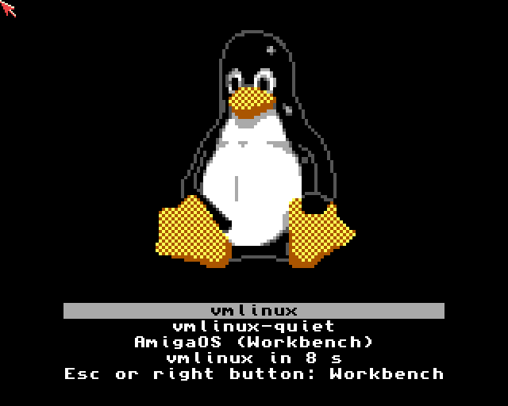

# amibootng

Boots Linux/m68k from AmigaOS.  It runs from `S:Startup-Sequence` after
`SetPatch`, shows Tux and a menu of the kernels in a drawer, and hands the
machine to the chosen kernel the way QEMU's `-kernel` does.  It needs a
68020 or better and fast RAM.  Only the fast RAM region the kernel is
loaded into is passed on.

    amibootng <kernel or drawer> [options] [kernel arguments]

A drawer is searched for m68k kernels; `vmlinux` is the default.  In the
menu, Up/Down or a click stop the countdown, Return or a click on an entry
boots it, and Esc or the right mouse button return to AmigaOS, for which
Tux makes way for the Boing ball.  A bar shows the kernel loading, and
"Starting Linux..." is the last thing amibootng shows before entering it.

Options:

    @<file>          the words in <file>; a word starting with ';' or '#'
                     comments out the rest of its line
    delay=<s>        countdown before booting the default (5)
    nosplash         no menu on the screen; boot the default unless serial
    serial[=<baud>]  offer the menu on the serial port too (9600)
    ramdisk=<file>   initrd
    model=<model>    a500, a500+, a600, a1000, a1200, a2000, a2500, a3000,
                     a3000t, a3000+, a4000, a4000t, cdtv, cd32 or draco
    noboot           load everything, then return to AmigaOS

The model is only found on its own on an A3000, A4000 or A4000T, whose
Kickstart says so; elsewhere the kernel only looks for the chips every
Amiga has unless `model=` is given.

A kernel with a `<kernel>.args` file next to it is booted with the
arguments in that file instead, apart from `model=`, which is kept.
`delay=`, `nosplash` and `serial` only work on amibootng's command line
and in the @files given there.

## Serial control

With `serial`, the menu is also offered on the serial port (with
`nosplash`, only there), for driving an Amiga from another machine.
amibootng sends lines starting with `amibootng: `, and takes commands one
per line, ended by CR or LF, without a prompt or echo:

    <n>          boot entry n
    boot         boot the selected entry
    args <...>   boot with these arguments instead; args alone clears them
    list         list the entries again
    quit         go to AmigaOS

It sends:

    <n> <label>       an entry, " *" after the selected one
    ready             the end of a list of entries
    <label> in <s> s  the countdown, every second
    stopped           input stopped the countdown
    args <...>        arguments accepted
    args cleared
    booting <kernel>
    loaded <kernel>
    starting <kernel>  the kernel is about to be entered
    boot cancelled
    error: <text>
    returning to AmigaOS   after an error, which any line dismisses

Any input stops the countdown, and moving the selection on the screen is
reported.  An `args` line is checked when it arrives and takes the same
words as a kernel's `.args`.  After an error the screen shows it for up
to 10 seconds, or until a key, a click or a line on the serial port.  Give the kernel `console=ttyS0,<baud>` to
keep the conversation going after the handover.

    amibootng: 0 vmlinux *
    amibootng: 1 vmlinux-test
    amibootng: 2 AmigaOS (Workbench)
    amibootng: ready
    amibootng: vmlinux in 5 s
    args root=/dev/sda3 console=ttyS0,9600              (sent)
    amibootng: stopped
    amibootng: args root=/dev/sda3 console=ttyS0,9600
    1                                                   (sent)
    amibootng: booting SYS:Linux/vmlinux-test
    Linux version ...

## Installing

`amibootng.adf` is an install floppy for the AmigaOS Installer, which is on
the Install disk of AmigaOS 3.x.  `Install-amibootng` copies amibootng to
`C:`, makes a drawer for the kernels (`SYS:Linux`) with an
`amibootng.args`, and adds amibootng to `S:Startup-Sequence` after
`SetPatch`, keeping the original as `S:Startup-Sequence.pre-amibootng`.
Running it again updates amibootng and leaves `amibootng.args` alone.
`Remove-amibootng` takes it out again.

## Building

    git clone --recursive <repo>
    meson setup build --cross-file m68k-linux-gnu.txt
    ninja -C build

This needs `gcc-m68k-linux-gnu`, meson and ninja.  The floppy is built
when amitools' `xdftool` is on `PATH`.  The Installer is not included, so
it has to be in `C:` on the Amiga, unless `-Dinstaller=<path>` puts it on
the floppy.

`test/` has a kernel config small enough to boot with an initramfs in
16MB, a script that makes a busybox initramfs, and one that sets up a
Workbench disk image for QEMU's A3000.

## Licence

amibootng is under the GPL version 2, see `LICENSE`.
`data/logo_linux_vga16.ppm` is the Linux kernel's boot logo; Tux was drawn
by Larry Ewing (lewing@isc.tamu.edu) using The GIMP, and may be used as
long as he is credited.
